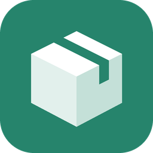

# Parcello für Home Assistant

[](https://hacs.xyz/docs/faq/custom_repositories)
[](https://github.com/sebiweise/home-assistant-parcello/actions/workflows/validate.yml)
[](https://github.com/sebiweise/home-assistant-parcello/actions/workflows/security.yml)
[](https://sonarcloud.io/summary/new_code?id=sebiweise_home-assistant-parcello)
[](https://github.com/sebiweise/home-assistant-parcello/releases)

Eine Home-Assistant-Integration für die Sendungsverfolgung von [Parcello](https://www.parcello.org). Parcello verfolgt
Pakete von DHL, Hermes, DPD, GLS, UPS, Amazon und weiteren Paketdiensten und sagt die Zustellung auf ein Zeitfenster
genau voraus. Die Integration holt die Sendungen deines Parcello-Kontos nach Home Assistant:

- je Sendung ein Sensor mit Status, Zustellfenster und letztem Ereignis
- Sensoren für erwartete Sendungen, Sendungen in Zustellung und die nächste Zustellung
- ein Kalender mit den vorhergesagten Zustellfenstern
- ein Event bei jeder Statusänderung, z. B. für eine Benachrichtigung „Paket ist in Zustellung“
- Services zum Hinzufügen und Entfernen von Sendungen, z. B. aus einer Automation heraus

> [!WARNING]
> Diese Integration ist ein Community-Projekt und steht in keiner Verbindung zu Parcello. Parcello bietet keine
> öffentliche Schnittstelle für Privatkunden an. Die Integration nutzt dieselbe Schnittstelle wie die Parcello-App
> und die Web-App. Ändert Parcello diese Schnittstelle, kann die Integration ohne Vorwarnung ausfallen.

## Installation

### Über HACS (empfohlen)

1. HACS öffnen → Menü (⋮) → **Benutzerdefinierte Repositories**
2. URL `https://github.com/sebiweise/home-assistant-parcello` mit Kategorie **Integration** hinzufügen
3. „Parcello“ installieren und Home Assistant neu starten
4. **Einstellungen → Geräte & Dienste → Integration hinzufügen → Parcello**

### Manuell

Den Ordner `custom_components/parcello` nach `<config>/custom_components/parcello` kopieren und Home Assistant neu
starten.

Das Symbol liegt in `custom_components/parcello/brand/` und wird ab Home Assistant 2026.3 angezeigt. Es ist ein
neutrales Paketsymbol, nicht das Logo von Parcello.

## Einrichtung

Bei der Einrichtung meldest du dich mit der **E-Mail-Adresse** und dem **Passwort** deines Parcello-Kontos an. Ein Konto
legst du in der [Parcello-App](https://www.parcello.org) oder in der [Web-App](https://www.parcello.org/app/) an. Die
Anmeldung mit Apple oder Facebook wird nicht unterstützt.

Home Assistant speichert nur den Anmelde-Token, nicht dein Passwort. Lehnt Parcello den Token später ab, fragt Home
Assistant unter **Einstellungen → Geräte & Dienste** erneut nach dem Passwort.

Mehrere Parcello-Konten lassen sich nebeneinander einrichten, jedes als eigener Eintrag.

### Optionen

Unter **Einstellungen → Geräte & Dienste → Parcello → Konfigurieren**:

| Option | Beschreibung |
| --- | --- |
| Aktualisierungsintervall | Minuten zwischen zwei Abfragen (5 bis 240, Standard 15). Parcello fragt die Paketdienste selbst ab, ein kürzeres Intervall bringt also keine aktuelleren Daten |
| Zugestellte Sendungen behalten | So viele Tage nach dem letzten Sendungsereignis behält eine zugestellte Sendung ihren Sensor (0 bis 30, Standard 3; 0 = sofort entfernen). In der Parcello-App bleibt die Sendung, bis du sie dort löschst |

## Entitäten

Alle Entitäten gehören zum Gerät **Parcello**.

| Entität | Beschreibung |
| --- | --- |
| `sensor.parcello_<name der sendung>` | Status einer Sendung (siehe unten). Attribute: `tracking_id` (Sendungsnummer), `carrier` (Paketdienst), `delivery_start` und `delivery_end` (vorhergesagtes Zustellfenster), `last_event`, `last_event_time`, `last_event_location`, `last_event_code`, `outgoing` (selbst verschickt), `pickup`, `rescheduled`, `tracking_url`, `parcel_id` |
| `sensor.parcello_expected_parcels` | Anzahl der erwarteten Sendungen, also eingehende Sendungen, die noch nicht zugestellt sind. Attribut `parcels` mit allen, nach Zustellfenster sortiert |
| `sensor.parcello_out_for_delivery` | Anzahl der Sendungen, die gerade in Zustellung sind. Attribut `parcels` |
| `sensor.parcello_next_delivery` | Beginn des nächsten Zustellfensters. Attribute `name`, `tracking_id`, `carrier`, `status`, `delivery_start`, `delivery_end` |
| `calendar.parcello_deliveries` | Zustellfenster aller erwarteten Sendungen |

Neue Sendungen bekommen bei der nächsten Aktualisierung automatisch einen Sensor. Löschst du eine Sendung in der
Parcello-App, verschwindet auch ihr Sensor.

| Status | Bedeutung |
| --- | --- |
| `in_transit` | Unterwegs |
| `out_for_delivery` | In Zustellung (letztes Ereignis des Paketdienstes) |
| `delivered` | Zugestellt (vom Paketdienst oder von dir in der App) |
| `warning` | Verzögert |
| `problem` | Problem bei der Zustellung |
| `returned` | Rücksendung |
| `loading` | Parcello aktualisiert die Sendung gerade |
| `no_data_yet` | Der Paketdienst hat noch keine Daten |
| `missing_info` | Angaben fehlen, z. B. die Sendungsnummer |
| `no_address` | Die Lieferadresse fehlt |

Für erwartete Sendungen zählen alle Status außer `delivered` und `returned`; selbst verschickte Sendungen
(`outgoing: true`) werden nicht mitgezählt.

## Services

### `parcello.add_parcel`

Fügt dem Parcello-Konto eine Sendung hinzu. Ohne `carrier` erkennt Parcello den Paketdienst anhand der Sendungsnummer.

```yaml
action: parcello.add_parcel
data:
  tracking_id: "00340434161094042557"
  name: Neue Schuhe          # optional, sonst die Sendungsnummer
  carrier: DHL               # optional
  config_entry_id: abc123    # nur bei mehreren Konten nötig
response_variable: result    # optional: {"parcel_id": "...", "carrier": "DHL"}
```

### `parcello.remove_parcel`

Löscht alle Sendungen mit dieser Sendungsnummer aus dem Parcello-Konto (Groß-/Kleinschreibung egal).

```yaml
action: parcello.remove_parcel
data:
  tracking_id: "00340434161094042557"
  config_entry_id: abc123    # optional, sonst alle Konten
```

## Events

| Event | Daten |
| --- | --- |
| `parcello_status_changed` | `config_entry_id`, `parcel_id`, `tracking_id`, `name`, `carrier`, `old_status` (`null` bei einer neuen Sendung), `status`, `outgoing`, `last_event` (`code`, `message`, `timestamp`, `location`) |

Das Event kommt bei jeder Statusänderung und bei jeder neuen Sendung, aber nicht für die Sendungen, die beim Start von
Home Assistant schon da sind.

## Beispiel-Automationen

**Benachrichtigen, wenn ein Paket in Zustellung ist**

```yaml
automation:
  - alias: "Paket in Zustellung"
    triggers:
      - trigger: event
        event_type: parcello_status_changed
        event_data:
          status: out_for_delivery
          outgoing: false
    actions:
      - action: notify.mobile_app_mein_handy
        data:
          title: "📦 {{ trigger.event.data.name }} kommt heute"
          message: >-
            {{ trigger.event.data.carrier }}:
            {{ trigger.event.data.last_event.message or 'in Zustellung' }}
```

**Bei Problemen mit einer Sendung benachrichtigen**

```yaml
automation:
  - alias: "Paket: Problem"
    triggers:
      - trigger: event
        event_type: parcello_status_changed
        event_data:
          status: problem
    actions:
      - action: persistent_notification.create
        data:
          title: "Problem mit {{ trigger.event.data.name }}"
          message: "{{ trigger.event.data.last_event.message }}"
```

**Eine Stunde vor dem Zustellfenster erinnern**

```yaml
automation:
  - alias: "Paket: Zustellung heute"
    triggers:
      - trigger: calendar
        event: start
        entity_id: calendar.parcello_deliveries
        offset: "-01:00:00"
    actions:
      - action: notify.mobile_app_mein_handy
        data:
          title: "{{ trigger.calendar_event.summary }}"
          message: >-
            Zustellung zwischen
            {{ as_datetime(trigger.calendar_event.start).strftime('%H:%M') }} und
            {{ as_datetime(trigger.calendar_event.end).strftime('%H:%M') }} Uhr
```

**Erwartete Sendungen am Dashboard anzeigen** (Markdown-Karte, nur sichtbar, wenn etwas unterwegs ist)

```yaml
type: markdown
visibility:
  - condition: numeric_state
    entity: sensor.parcello_expected_parcels
    above: 0
content: >-
  
  **{{ parcel.name }}** ({{ parcel.carrier or '?' }}):
  {{ as_timestamp(parcel.delivery_start) | timestamp_custom('%a %H:%M') }}
  noch keine Prognose

  
```

## Fehlersuche

- Die Integration schreibt jede Abfrage ins Log, wenn du in der `configuration.yaml` Folgendes einträgst:

  ```yaml
  logger:
    logs:
      custom_components.parcello: debug
  ```
- Unter **Einstellungen → Geräte & Dienste → Parcello → ⋮ → Diagnose herunterladen** bekommst du die Rohdaten der
  Sendungen, ohne Anmeldedaten, Sendungsnummern, Namen, Orte und Meldungstexte. Häng sie an einen Fehlerbericht an, wenn ein Status
  oder ein Zustellfenster nicht stimmt.

## Entwicklung

### Devcontainer (empfohlen)

Das Repository enthält einen [Devcontainer](.devcontainer/devcontainer.json) für VS Code / GitHub Codespaces
(Python 3.14, Ruff, Pytest). Nach dem Öffnen werden die Abhängigkeiten automatisch installiert.

| Befehl | Zweck |
| --- | --- |
| `scripts/develop` | Startet eine lokale Home-Assistant-Instanz mit der Integration auf Port 8123 (Konfiguration in `config/`) |
| `scripts/test` | Ruff (Lint + Format) und Pytest, wie in der CI |
| `scripts/setup` | Installiert die gesperrten Abhängigkeiten aus `requirements_test.txt` |
| `scripts/lock` | Erzeugt `requirements_test.txt` (mit Hashes) neu aus `requirements_test.in` |

### Ohne Devcontainer

Benötigt Python 3.14 (aktuelle Home-Assistant-Versionen setzen ≥ 3.14.2 voraus).

```bash
scripts/setup
scripts/test
```

### Abhängigkeiten

Die Test-Abhängigkeiten sind in `requirements_test.txt` inklusive Hashes gesperrt und werden ausschließlich
als Wheels installiert (`--only-binary :all: --require-hashes`). Ausnahmen sind nur `mock-open` und `pyric`,
die ausschließlich als Quellpaket veröffentlicht werden. Dependabot aktualisiert sie wöchentlich,
ebenso die per Commit-SHA gepinnten GitHub Actions und das Devcontainer-Image.

## Lizenz

[MIT](LICENSE)
